# Terminal Trivia: State & Score Broadcast Sequence Diagram

**Course:** CS 457 Computer Networks, Sprint 2
**Author:** Jason Arthur

This diagram shows how the single-threaded `selectors` server from
[`concurrency_design.md`](concurrency_design.md) handles a full game: players joining, an answer
being validated against the player's answer window, the round closing, and the same
`STATE_UPDATE` being broadcast to both clients. All 11 message types from
[`protocol_blueprint.md`](protocol_blueprint.md) appear: `CONNECT`, `LOBBY_WAIT`, `GAME_START`,
`QUESTION`, `MOVE`, `WAGER_REQUEST`, `WAGER`, `STATE_UPDATE`, `ERROR`, `DISCONNECT` and
`GAME_OVER`.

**Reading the diagram.** Trivia does not alternate turns. A player's "turn" is their answer
window: it opens when the server sends `QUESTION` and closes on that player's first valid `MOVE` or
at the 15 s deadline. Both players answer the same question at the same time, so "turn switch" in
this game means "the round closes and the next question opens for both". Every `par` block is one
atomic handler in the event loop: both copies are queued in the same step, before the server
processes any other event.

---

## 1. Sequence Diagram

```mermaid
sequenceDiagram
    autonumber
    actor C1 as Client 1 (Alice, Player_1)
    participant S as Game Server (selectors loop)
    actor C2 as Client 2 (Bob, Player_2)
    actor C3 as Client 3 (late joiner)

    rect rgba(100, 150, 255, 0.12)
    Note over C1,C3: Phase 1. Waiting to join, then joined
    C1->>S: TCP connect to port 5457
    Note over S: accept(), setblocking(False),<br/>register EVENT_READ, role = None
    C1->>S: CONNECT (player_name: Alice)
    alt name valid and room empty
        Note over S: role = Player_1<br/>state WAITING_FOR_PLAYERS
        S-->>C1: LOBBY_WAIT (assigned_id Player_1, players_connected 1 of 2)
    else name fails 1-16 chars, letters, digits, _ or -
        S-->>C1: ERROR INVALID_NAME (client may retry CONNECT)
    end
    C2->>S: TCP connect + CONNECT (player_name: Bob)
    Note over S: role = Player_2, room full<br/>one handler starts the game
    par GAME_START queued to both in one handler
        S-->>C1: GAME_START (your_id Player_1, players, 3 rounds x 3 questions, 15 s)
    and
        S-->>C2: GAME_START (your_id Player_2, players, 3 rounds x 3 questions, 15 s)
    end
    C3->>S: TCP connect + CONNECT (player_name: Carol)
    S-->>C3: ERROR LOBBY_FULL
    Note over S,C3: close_after_flush, then unregister and close C3 only
    end

    rect rgba(120, 200, 120, 0.12)
    Note over C1,C2: Phase 2. Answer windows, validation and score broadcast
    loop 9 questions R1Q1 to R3Q3 (100 / 200 / 300 points by round)
        par QUESTION queued to both in one handler
            S-->>C1: QUESTION (question_id R2Q1, choices A-D, points 200, time_limit 15)
        and
            S-->>C2: QUESTION (question_id R2Q1, choices A-D, points 200, time_limit 15)
        end
        Note over S: open_windows = Player_1, Player_2<br/>deadline = monotonic() + 15 s
        C1->>S: MOVE (question_id R2Q1, answer C)
        Note over S: Validate: state PLAYER_TURN?<br/>question_id is current?<br/>Player_1 window open? answer in A-D?
        alt valid MOVE
            Note over S: answers[Player_1] = C, close Player_1 window<br/>no reply, so the result is not leaked early
        else answer not A-D
            S-->>C1: ERROR INVALID_ANSWER (window stays open)
        else stale question_id, or Player_1 already answered
            S-->>C1: ERROR OUT_OF_TURN (message ignored, state unchanged)
        else player_id does not match this socket
            S-->>C1: ERROR ID_MISMATCH (message ignored)
        else frame is not valid JSON or misses a key
            S-->>C1: ERROR MALFORMED_MESSAGE (connection kept open)
        end
        C1->>S: MOVE (question_id R2Q1, answer A) sent again
        S-->>C1: ERROR OUT_OF_TURN (first answer C stands)
        alt Player_2 answers before the deadline
            C2->>S: MOVE (question_id R2Q1, answer B)
            Note over S: Same validation passes<br/>both windows closed, so close_round() runs
        else 15 s deadline reached first
            Note over S: select() timeout fires, check_deadline()<br/>runs before any frame, answers[Player_2] = null
            C2->>S: MOVE (question_id R2Q1, answer B) arrives late
            S-->>C2: ERROR OUT_OF_TURN (window already closed)
        end
        Note over S: close_round(): score both answers once,<br/>update scores and history, deadline = None
        par same STATE_UPDATE bytes queued to both in one handler
            S-->>C1: STATE_UPDATE (correct_answer C, results, scores, next QUESTION)
        and
            S-->>C2: STATE_UPDATE (correct_answer C, results, scores, next QUESTION)
        end
    end
    end

    rect rgba(255, 190, 90, 0.14)
    Note over C1,C2: Phase 3. Tiebreaker, only if scores are tied after R3Q3
    opt scores tied after 9 questions
        par WAGER_REQUEST queued to both
            S-->>C1: WAGER_REQUEST (max_wager 900, scores, time_limit 15)
        and
            S-->>C2: WAGER_REQUEST (max_wager 900, scores, time_limit 15)
        end
        C1->>S: WAGER (amount 500)
        alt 0 to max_wager and first wager
            Note over S: wagers[Player_1] = 500
        else amount negative, too large or not an integer
            S-->>C1: ERROR INVALID_WAGER (may resend)
        end
        C2->>S: MOVE (question_id R3Q3, answer D) during the wager window
        S-->>C2: ERROR OUT_OF_TURN (no answer window open)
        C2->>S: WAGER (amount 300)
        Note over S: Both wagers in, or deadline reached<br/>missing wager counts as 0
        par tiebreaker QUESTION queued to both
            S-->>C1: QUESTION (question_id TB, points 0, time_limit 15)
        and
            S-->>C2: QUESTION (question_id TB, points 0, time_limit 15)
        end
        C1->>S: MOVE (question_id TB, answer A)
        C2->>S: MOVE (question_id TB, answer B)
        Note over S: Correct adds 2 x wager<br/>wrong or missing subtracts wager
        par STATE_UPDATE queued to both
            S-->>C1: STATE_UPDATE (question_id TB, results, scores, next GAME_OVER)
        and
            S-->>C2: STATE_UPDATE (question_id TB, results, scores, next GAME_OVER)
        end
    end
    end

    rect rgba(220, 110, 110, 0.12)
    Note over C1,C2: Phase 4. End of game and teardown
    alt game finished normally
        Note over S: CHECK_WIN_DRAW: WIN most_points, WIN tiebreaker,<br/>or DRAW tied_after_tiebreaker
        par GAME_OVER queued to both
            S-->>C1: GAME_OVER (result, winner, reason, final_scores)
        and
            S-->>C2: GAME_OVER (result, winner, reason, final_scores)
        end
    else Player_2 quits mid-game
        C2->>S: DISCONNECT (reason user_quit), then FIN
        Note over S: handle_client_disconnect(Player_2)<br/>deadline = None, game is forfeit
        S-->>C1: GAME_OVER (FORFEIT, winner Player_1, reason opponent_quit)
    else Player_2 link drops (EOF, RST or keepalive timeout)
        C2-xS: connection lost, no DISCONNECT
        Note over S: recv() returns empty bytes or raises<br/>handle_client_disconnect(Player_2)
        S-->>C1: GAME_OVER (FORFEIT, winner Player_1, reason opponent_disconnected)
    end
    Note over S: Flush outbufs, unregister, shutdown, close<br/>CLEANUP resets the Room, back to WAITING_FOR_PLAYERS
    end
```

---

## 2. Narrative

### 2.1 Waiting to join and joined (Phase 1)

Alice's TCP connection is accepted by the event loop and registered with `role = None`. Her
`CONNECT` is validated; because the room is empty she becomes `Player_1` and receives `LOBBY_WAIT`.
An invalid name gets `ERROR INVALID_NAME` and she may try again. When Bob's `CONNECT` arrives, the
same handler assigns `Player_2` and queues a separate `GAME_START` to each player (each copy has the
recipient's own `your_id`). A third client that connects while the room is full is still accepted
at the TCP level so it can be told why: it gets `ERROR LOBBY_FULL` and only its socket is closed.
The game in progress is not affected.

### 2.2 Move request, validation and state mutation (Phase 2)

The server queues the same `QUESTION` to both players in one handler and opens both answer windows
with one shared 15 s deadline. When Alice's `MOVE` arrives the server checks, in order: the game is
in `PLAYER_TURN`, the `question_id` is the current one, Alice's window is still open, and the answer
is `A` to `D`. Only if all checks pass does it record the answer and close her window.

A valid `MOVE` gets **no reply**. This is deliberate (blueprint Section 3.6): replying would tell
Alice whether she was right before Bob has answered. The result arrives for both players in the
`STATE_UPDATE`.

Every invalid case goes down an `else` branch that sends `ERROR` to the sender only and leaves the
game state untouched:

| Case | Error | Effect |
|---|---|---|
| Answer is not `A` to `D` | `INVALID_ANSWER` | Window stays open for a corrected answer |
| Second `MOVE` for the same question, or a stale `question_id` | `OUT_OF_TURN` | First answer stands |
| `MOVE` after the deadline, or during the wager window | `OUT_OF_TURN` | Ignored |
| `player_id` does not match the socket's role | `ID_MISMATCH` | Ignored |
| Frame is not valid JSON | `MALFORMED_MESSAGE` | Ignored, connection kept open |

### 2.3 Round close and synchronous broadcast (Phase 2)

The round closes in one of two ways: Bob's valid `MOVE` closes the last open window, or the
`select()` timeout fires at the deadline and Bob's missing answer is recorded as `null`. The loop
always checks the deadline before processing any frame, so a `MOVE` that arrives after the deadline
gets `OUT_OF_TURN` and is never counted.

Both paths call the same `close_round()`, which scores both answers once, updates `scores` and
`history`, and builds one `STATE_UPDATE`. The identical bytes are queued to both clients in that
handler, followed by the next `QUESTION`. Nothing else can run between those two queue operations,
so both players always see the same scores, in the same order, and neither ever sees the next
question before the result of the last one.

### 2.4 Score and leaderboard synchronization (Phases 2 and 3)

Every `STATE_UPDATE` carries the full `scores` table, not just the points for that question, so a
client's screen is always a copy of the server's totals. If the scores are tied after nine
questions, the server queues `WAGER_REQUEST` to both and runs a 15 s wager window. `MOVE` is
out of turn here and a bad amount gets `INVALID_WAGER`. Then it sends the tiebreaker `QUESTION TB`.
The tiebreaker `STATE_UPDATE` applies `+2 x wager` for a correct answer and `-wager` for a wrong or
missing one.

### 2.5 End of game and teardown (Phase 4)

A finished game ends with `GAME_OVER` queued to both players (`WIN` on most points or the
tiebreaker, otherwise `DRAW`). If a player sends `DISCONNECT`, or their link drops (EOF, RST or a
keepalive timeout), `handle_client_disconnect` cancels the deadline and sends the remaining player
`GAME_OVER` with `FORFEIT`. In every case the server flushes its queued frames, unregisters and
closes the sockets, and `CLEANUP` resets the room so the next pair of players can join.
