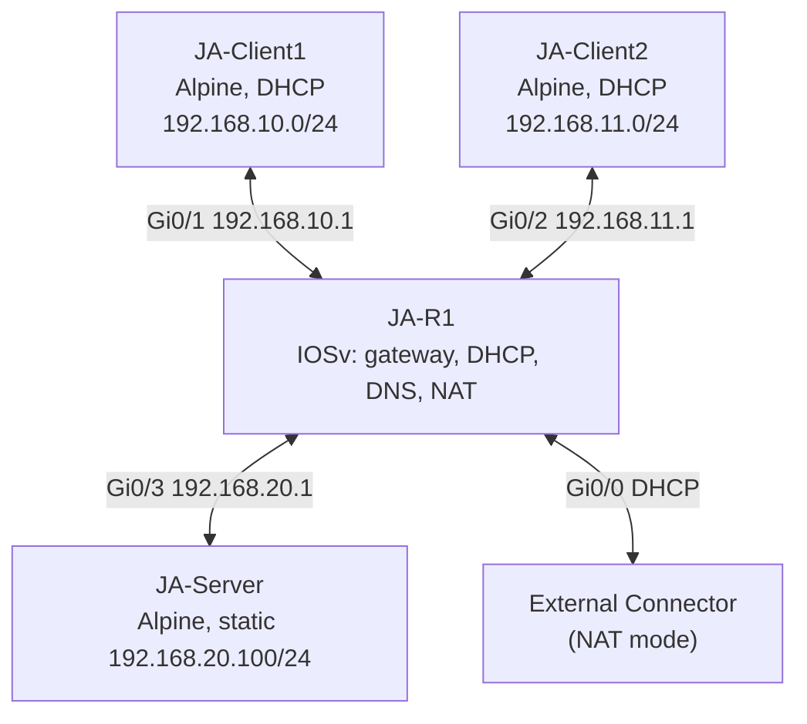

# Sprint 4 Runbook: CML 1-Router Topology

**Author:** Jason Arthur
**Course:** CS 457 Computer Networks, Fall 2026

Step-by-step instructions for building the Sprint 4 network in Cisco Modeling Labs (CML) and
collecting every piece of evidence the rubric asks for. Follow the steps in order. Each
"Save for the report" box says what to copy into
[`sprint_4_network_report.md`](../sprint_4_network_report.md).

---

## 1. Target Topology



| Node | CML node type | Connects to | Address |
|---|---|---|---|
| `JA-R1` | IOSv | all four links below | Gi0/1 `192.168.10.1/24`, Gi0/2 `192.168.11.1/24`, Gi0/3 `192.168.20.1/24`, Gi0/0 DHCP |
| `JA-Client1` | Alpine | `JA-R1` Gi0/1 | DHCP from `CLIENT1_POOL` |
| `JA-Client2` | Alpine | `JA-R1` Gi0/2 | DHCP from `CLIENT2_POOL` |
| `JA-Server` | Alpine | `JA-R1` Gi0/3 | Static `192.168.20.100/24`, gateway `192.168.20.1` |
| External Connector | External Connector (default NAT mode) | `JA-R1` Gi0/0 | `192.168.255.0/24` (CML assigns) |

The DNS name for the server is **`server.arthur.edu`**.

---

## 2. Build the Lab in CML

1. Create a new lab and name it `JA-Sprint4`.
2. Add one **IOSv** node, three **Alpine** nodes and one **External Connector** node.
3. Rename each node (select it, then edit **Label** in the node's settings) to the names in the
   table above. The initials must be exactly `JA-`, because the rubric checks them.
4. Draw the links. When you connect a link to `JA-R1`, pick the interface by name so the cabling
   matches the table:
   - `JA-Client1 eth0` to `JA-R1 GigabitEthernet0/1`
   - `JA-Client2 eth0` to `JA-R1 GigabitEthernet0/2`
   - `JA-Server eth0` to `JA-R1 GigabitEthernet0/3`
   - External Connector to `JA-R1 GigabitEthernet0/0`
5. Start the lab and wait until every node shows as booted (green).

> **Save for the report:** a screenshot of the whole topology canvas showing all five node labels.

---

## 3. Configure JA-R1

1. Open the `JA-R1` console. Press **Enter** until you see `Router>`. If IOSv asks
   `Would you like to enter the initial configuration dialog?`, type `no`.
2. Paste the whole of [`cml/r1_config.txt`](../cml/r1_config.txt). It sets the hostname to
   `JA-R1`, brings up the three gateways, creates both DHCP pools, adds the DNS record, sets up
   NAT to the External Connector and ends with `write memory`.
3. Check that it worked:

   ```text
   JA-R1# show ip interface brief
   JA-R1# show ip route
   JA-R1# show hosts
   ```

   Gi0/0 to Gi0/3 must show `up    up`. `show ip route` must list `192.168.10.0/24`,
   `192.168.11.0/24` and `192.168.20.0/24` as `C` (connected) routes, plus a default route
   learned on Gi0/0. `show hosts` must list `server.arthur.edu` with `192.168.20.100`.

> **Save for the report:** the full output of `show ip interface brief` and `show ip route`.
> (`show ip dhcp binding` comes later, after the clients have leases.)

---

## 4. Configure JA-Server (Static IP)

Open the `JA-Server` console and run:

```text
sudo ip addr add 192.168.20.100/24 dev eth0
sudo ip link set eth0 up
sudo ip route add default via 192.168.20.1
echo "nameserver 192.168.20.1" | sudo tee /etc/resolv.conf
```

Check it:

```text
ip addr show eth0
ip route
```

`ip addr` must show `inet 192.168.20.100/24`, and `ip route` must show
`default via 192.168.20.1 dev eth0`.

> These commands do not survive a node restart. If you stop and start the lab, run them again.

> **Save for the report:** the output of `ip addr show eth0` and `ip route` on `JA-Server`.

---

## 5. Get DHCP Leases on JA-Client1 and JA-Client2

On **each** client console:

```text
sudo ip link set eth0 up
sudo udhcpc -i eth0
ip addr show eth0
ip route
cat /etc/resolv.conf
```

| Check | JA-Client1 | JA-Client2 |
|---|---|---|
| `udhcpc` prints `lease of ... obtained` | `192.168.10.x` (usually `.2`) | `192.168.11.x` (usually `.2`) |
| `ip route` default gateway | `default via 192.168.10.1` | `default via 192.168.11.1` |
| `/etc/resolv.conf` | `nameserver 192.168.10.1` | `nameserver 192.168.11.1` |

Then, back on `JA-R1`:

```text
JA-R1# show ip dhcp binding
```

It must list two leases, one on `192.168.10.0/24` and one on `192.168.11.0/24`.

> **Save for the report:** the client outputs above (both clients) and `show ip dhcp binding`.

---

## 6. Test Connectivity and DNS from Both Clients

On **each** client:

```text
ping -4 -c 4 192.168.20.100
nslookup -type=A server.arthur.edu
ping -4 -c 4 server.arthur.edu
```

- Both pings must end with `4 packets transmitted, 4 packets received, 0% packet loss`.
- `nslookup` must show `Address: 192.168.20.100` from server `192.168.10.1` (Client 1) or
  `192.168.11.1` (Client 2).

Use `-4` and `-type=A` on Alpine. Without them Alpine also asks for an IPv6 (AAAA) record,
which R1 does not have, so `ping` says `bad address` and `nslookup` adds
`*** Can't find ...: No answer`. That is expected and not a fault.

> **Save for the report:** the `ping 192.168.20.100` and `nslookup -type=A server.arthur.edu`
> output from **both** clients.

---

## 7. Capture the DNS Lookup in Wireshark

1. In CML, select the link between `JA-Client1` and `JA-R1`, open its **Packet Capture**
   tab, and click **Start**. (This is the client's own link, so it shows the query leaving the
   client and the answer coming back from R1.)
2. On the `JA-Client1` console, run:

   ```text
   nslookup -type=A server.arthur.edu
   ```

3. Wait a few seconds, then **Stop** the capture and download it. Save it in the repository
   root as **`sprint_4_dns_lookup.pcap`**. If CML gives you a `.pcapng` file, open it in
   Wireshark and use **File > Save As** with the type set to `Wireshark/tcpdump/... - pcap`.
4. Open the file in Wireshark and type `dns` in the display filter. You should see two packets:
   - **Standard query** `A server.arthur.edu` from `192.168.10.x` to `192.168.10.1`, UDP port 53.
   - **Standard query response** `A server.arthur.edu A 192.168.20.100` from `192.168.10.1`.
5. Click the response, expand **Domain Name System (response) > Answers** in the middle pane,
   and take a screenshot that shows the packet list and the answer `192.168.20.100`.
6. Annotate the screenshot (arrows or boxes) to label: the query, the response, UDP port 53,
   the client and R1 addresses, and the answer `192.168.20.100`.

> Keep the `.pcap` file raw. A plain `.pcap` cannot hold Wireshark packet comments, so the
> annotations go on the screenshot in the report.

> **Save for the report:** the annotated Wireshark screenshot.

---

## 8. Optional: Play the Game Across the Subnets

Not graded in Sprint 4, but this is the end-to-end test of Sprints 1 to 3. Because R1 has NAT to
the External Connector, the nodes can download packages and clone the repository.

On all three Alpine nodes:

```text
sudo apk update
sudo apk add python3 git
git clone https://github.com/Jason-Arthur/CS457-Terminal-Trivia.git
cd CS457-Terminal-Trivia
sync
```

Then:

```text
# JA-Server
python3 server.py -p 5457

# JA-Client1 and JA-Client2
python3 client.py -i server.arthur.edu -p 5457
```

---

## 9. Export the Topology YAML

1. On `JA-R1`, make sure the config is saved: `write memory`.
2. In CML, use the lab's **Extract Configurations** action (lab menu, or each node's menu) so the
   current router config is stored in the lab. This puts the R1 config inside the YAML.
3. Download the lab (**Lab > Download Lab** / **Export**) and save it in the repository root as
   **`sprint_4_topology.yaml`**.
4. Open the YAML in a text editor and check that it lists all five nodes with their `JA-` labels
   and that `JA-R1`'s configuration contains `ip host server.arthur.edu 192.168.20.100`.

---

## 10. Evidence Checklist

| Rubric criterion | Evidence | Runbook step |
|---|---|---|
| 1. Single-router architecture | Topology screenshot, `show ip interface brief`, `show ip route`, server `ip addr` / `ip route` | 2, 3, 4 |
| 2. DHCP multi-subnet allocation | Client `udhcpc` / `ip route` / `resolv.conf`, `show ip dhcp binding` | 5 |
| 3. Authoritative DNS | `nslookup -type=A server.arthur.edu` from both clients | 6 |
| 4. Connectivity and DNS capture | `ping 192.168.20.100` from both clients, `sprint_4_dns_lookup.pcap` | 6, 7 |
| 5. YAML export and report | `sprint_4_topology.yaml`, annotated Wireshark screenshot, completed report | 7, 9 |

Commit to the repository root:

- `sprint_4_topology.yaml`
- `sprint_4_dns_lookup.pcap`
- `sprint_4_network_report.md` (filled in) and its screenshots in `docs/images/sprint4/`
