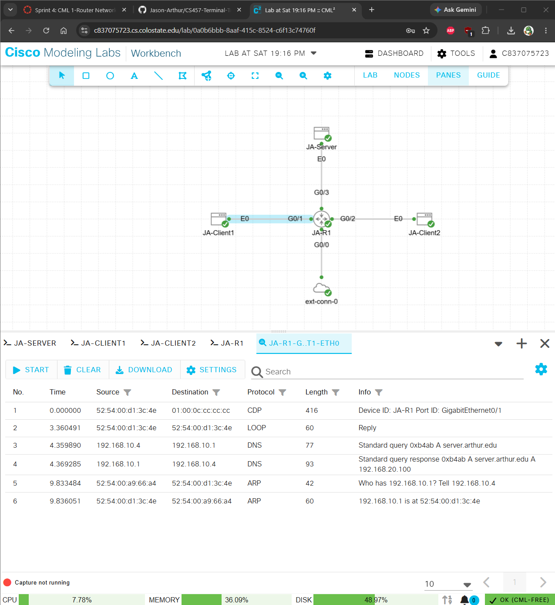

# Sprint 4 Network Verification Report: CML 1-Router Topology

**Student:** Jason Arthur (JA)
**Course:** CS 457 Computer Networks, Fall 2026
**Game server FQDN:** `server.arthur.edu` -> `192.168.20.100`
**Lab files:** [`sprint_4_topology.yaml`](sprint_4_topology.yaml),
[`sprint_4_dns_lookup.pcap`](sprint_4_dns_lookup.pcap)

> **TEMPLATE.** Every `TODO` below is filled in from the CML lab by following
> [`docs/sprint4_runbook.md`](docs/sprint4_runbook.md). Screenshots go in `docs/images/sprint4/`.

---

## 1. Topology

A single Cisco IOSv router, `JA-R1`, connects three subnets on three routed interfaces. All
three subnets are directly connected, so no static routes are needed. A fourth interface, Gi0/0,
connects to the CML External Connector and uses NAT overload so the nodes can reach the internet
to install packages.


<!-- TODO: screenshot of the CML canvas showing JA-Client1, JA-Client2, JA-Server, JA-R1 and the External Connector -->

| Node | Interface | Subnet | Address | How assigned |
|---|---|---|---|---|
| `JA-R1` | Gi0/1 | Subnet A `192.168.10.0/24` | `192.168.10.1` | Static (gateway for Client 1) |
| `JA-R1` | Gi0/2 | Subnet B `192.168.11.0/24` | `192.168.11.1` | Static (gateway for Client 2) |
| `JA-R1` | Gi0/3 | Subnet C `192.168.20.0/24` | `192.168.20.1` | Static (gateway for the server) |
| `JA-R1` | Gi0/0 | External Connector `192.168.255.0/24` | TODO | DHCP from CML |
| `JA-Client1` | eth0 | Subnet A | TODO (`192.168.10.x`) | DHCP, `CLIENT1_POOL` |
| `JA-Client2` | eth0 | Subnet B | TODO (`192.168.11.x`) | DHCP, `CLIENT2_POOL` |
| `JA-Server` | eth0 | Subnet C | `192.168.20.100` | Static, gateway `192.168.20.1` |

The full router configuration is in [`cml/r1_config.txt`](cml/r1_config.txt) and is also embedded
in `sprint_4_topology.yaml`.

---

## 2. Single-Router Multi-Subnet Architecture (Criterion 1)

### 2.1 `show ip interface brief` on JA-R1

```text
TODO: paste output
```

All four interfaces are `up`/`up` with the addresses in the table above.

### 2.2 `show ip route` on JA-R1

```text
TODO: paste output
```

`192.168.10.0/24`, `192.168.11.0/24` and `192.168.20.0/24` appear as `C` (connected) routes on
Gi0/1, Gi0/2 and Gi0/3. The default route via Gi0/0 comes from the External Connector's DHCP lease.

### 2.3 Game server static address (`JA-Server`)

```text
TODO: paste output of "ip addr show eth0" and "ip route"
```

The server has `192.168.20.100/24` on eth0 and `default via 192.168.20.1`, so its replies to
clients on other subnets go back through R1.

---

## 3. DHCP Multi-Subnet Dynamic IP Allocation (Criterion 2)

R1 runs two pools. The gateway address `.1` is excluded from each, and each pool hands out its
subnet's gateway as both the default router (option 3) and the DNS server (option 6).

```text
ip dhcp excluded-address 192.168.10.1
ip dhcp excluded-address 192.168.11.1
ip dhcp pool CLIENT1_POOL
 network 192.168.10.0 255.255.255.0
 default-router 192.168.10.1
 dns-server 192.168.10.1
ip dhcp pool CLIENT2_POOL
 network 192.168.11.0 255.255.255.0
 default-router 192.168.11.1
 dns-server 192.168.11.1
```

### 3.1 JA-Client1 lease

```text
TODO: paste output of "sudo udhcpc -i eth0", "ip addr show eth0", "ip route", "cat /etc/resolv.conf"
```

### 3.2 JA-Client2 lease

```text
TODO: paste output of "sudo udhcpc -i eth0", "ip addr show eth0", "ip route", "cat /etc/resolv.conf"
```

### 3.3 `show ip dhcp binding` on JA-R1

```text
TODO: paste output
```

Both clients hold active leases, one on each client subnet.

---

## 4. Authoritative DNS Resolution (Criterion 3)

R1 answers DNS queries on UDP/TCP port 53 with a static A record for the game server:

```text
ip domain lookup
ip dns server
ip host server.arthur.edu 192.168.20.100
```

### 4.1 `nslookup -type=A server.arthur.edu` on JA-Client1

```text
TODO: paste output
```

### 4.2 `nslookup -type=A server.arthur.edu` on JA-Client2

```text
TODO: paste output
```

Both clients resolve `server.arthur.edu` to `192.168.20.100`, each using its own gateway as the
DNS server. `-type=A` is used because Alpine otherwise also asks for an AAAA (IPv6) record, which
R1 does not have.

---

## 5. Cross-Subnet Connectivity and DNS Capture (Criterion 4)

### 5.1 `ping 192.168.20.100` from JA-Client1

```text
TODO: paste output
```

### 5.2 `ping 192.168.20.100` from JA-Client2

```text
TODO: paste output
```

Both clients reach the game server across R1 with 0% packet loss.

### 5.3 Wireshark DNS exchange

Capture file: [`sprint_4_dns_lookup.pcap`](sprint_4_dns_lookup.pcap), taken on the
`JA-Client1` <-> `JA-R1` Gi0/1 link while running `nslookup -type=A server.arthur.edu` on
`JA-Client1`.


<!-- TODO: annotated screenshot: query, response, UDP 53, addresses, answer 192.168.20.100 -->

| # | Source | Destination | Protocol | Info |
|---|---|---|---|---|
| 1 | TODO (`192.168.10.x`) | `192.168.10.1` | DNS (UDP 53) | Standard query `A server.arthur.edu` |
| 2 | `192.168.10.1` | TODO (`192.168.10.x`) | DNS (UDP 53) | Standard query response `A server.arthur.edu A 192.168.20.100` |

1. **Query:** `JA-Client1` sends a DNS Standard Query for the A record of `server.arthur.edu` to
   the DNS server it learned from DHCP option 6, `192.168.10.1` (R1's Gi0/1), on UDP port 53.
2. **Response:** R1 answers from its local host table (`ip host`) with one A record,
   `192.168.20.100`. The response has the same transaction ID as the query.

---

## 6. Topology Export (Criterion 5)

[`sprint_4_topology.yaml`](sprint_4_topology.yaml) is the CML export of the running lab. It
contains the five nodes (`JA-Client1`, `JA-Client2`, `JA-Server`, `JA-R1`, External Connector),
their interfaces and links, and R1's saved configuration.

---

## 7. Summary

| Acceptance criterion | Result | Evidence |
|---|---|---|
| Single router R1 connects all three subnets | TODO | §2.1, §2.2 |
| R1 issues IPs, gateways and DNS servers from separate pools | TODO | §3 |
| Server has static `192.168.20.100/24`, gateway `192.168.20.1` | TODO | §2.3 |
| DNS resolves `server.arthur.edu` to `192.168.20.100` (capture and screenshots) | TODO | §4, §5.3 |
| Both clients ping the server with no loss | TODO | §5.1, §5.2 |
| Deliverables committed with `sprint_4_` names | TODO | Repository root |
