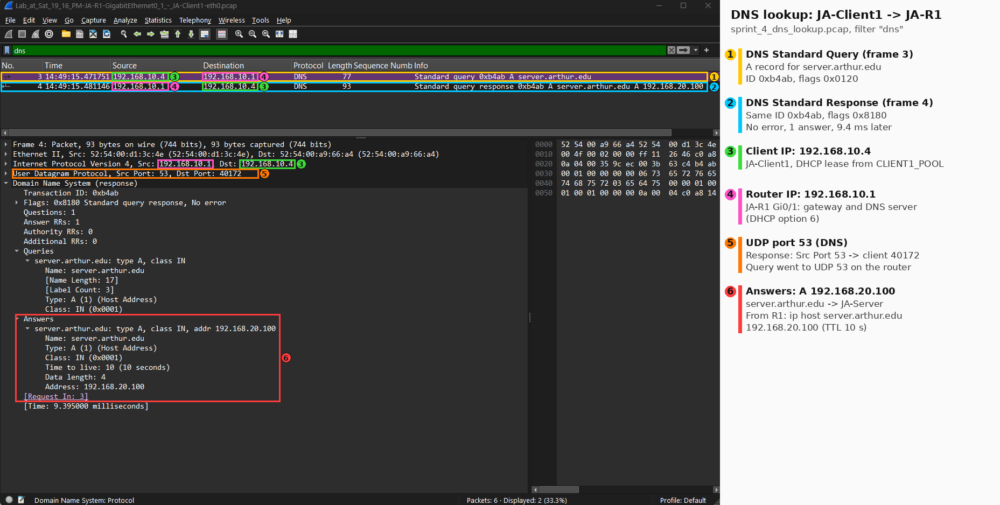

# Sprint 4 Network Verification Report: CML 1-Router Topology

**Student:** Jason Arthur (JA)
**Course:** CS 457 Computer Networks, Fall 2026
**Game server FQDN:** `server.arthur.edu` -> `192.168.20.100`
**Lab files:** [`sprint_4_topology.yaml`](sprint_4_topology.yaml),
[`sprint_4_dns_lookup.pcap`](sprint_4_dns_lookup.pcap)

---

## 1. Topology

A single Cisco IOSv router, `JA-R1`, connects three subnets on three routed interfaces. All
three subnets are directly connected, so no static routes are needed. A fourth interface, Gi0/0,
connects to the CML External Connector and uses NAT overload so the nodes can reach the internet
to install packages.


*The CML workbench with all five nodes running. The packet capture pane below the canvas is the
Gi0/1 to JA-Client1 capture used in section 5.3.*

| Node | Interface | Subnet | Address | How assigned |
|---|---|---|---|---|
| `JA-R1` | Gi0/1 | Subnet A `192.168.10.0/24` | `192.168.10.1` | Static (gateway for Client 1) |
| `JA-R1` | Gi0/2 | Subnet B `192.168.11.0/24` | `192.168.11.1` | Static (gateway for Client 2) |
| `JA-R1` | Gi0/3 | Subnet C `192.168.20.0/24` | `192.168.20.1` | Static (gateway for the server) |
| `JA-R1` | Gi0/0 | External Connector `192.168.255.0/24` | `192.168.255.76` | DHCP from CML |
| `JA-Client1` | eth0 | Subnet A | `192.168.10.4` | DHCP, `CLIENT1_POOL` |
| `JA-Client2` | eth0 | Subnet B | `192.168.11.4` | DHCP, `CLIENT2_POOL` |
| `JA-Server` | eth0 | Subnet C | `192.168.20.100` | Static, gateway `192.168.20.1` |

The full router configuration is in [`cml/r1_config.txt`](cml/r1_config.txt) and is also embedded
in `sprint_4_topology.yaml`.

---

## 2. Single-Router Multi-Subnet Architecture (Criterion 1)

### 2.1 `show ip interface brief` on JA-R1

```text
JA-R1#show ip interface brief
Interface                  IP-Address      OK? Method Status                Protocol
GigabitEthernet0/0         192.168.255.76  YES DHCP   up                    up
GigabitEthernet0/1         192.168.10.1    YES manual up                    up
GigabitEthernet0/2         192.168.11.1    YES manual up                    up
GigabitEthernet0/3         192.168.20.1    YES manual up                    up
NVI0                       192.168.10.1    YES unset  up                    up
```

All four interfaces are `up`/`up` with the addresses in the table above. `NVI0` is the NAT
Virtual Interface that IOS creates automatically once `ip nat inside`/`outside` is configured.
It is not a cabled port.

### 2.2 `show ip route` on JA-R1

```text
JA-R1#show ip route
Codes: L - local, C - connected, S - static, R - RIP, M - mobile, B - BGP
       D - EIGRP, EX - EIGRP external, O - OSPF, IA - OSPF inter area
       N1 - OSPF NSSA external type 1, N2 - OSPF NSSA external type 2
       E1 - OSPF external type 1, E2 - OSPF external type 2
       i - IS-IS, su - IS-IS summary, L1 - IS-IS level-1, L2 - IS-IS level-2
       ia - IS-IS inter area, * - candidate default, U - per-user static route
       o - ODR, P - periodic downloaded static route, H - NHRP, l - LISP
       a - application route
       + - replicated route, % - next hop override, p - overrides from PfR

Gateway of last resort is 192.168.255.1 to network 0.0.0.0

S*    0.0.0.0/0 [254/0] via 192.168.255.1
      192.168.10.0/24 is variably subnetted, 2 subnets, 2 masks
C        192.168.10.0/24 is directly connected, GigabitEthernet0/1
L        192.168.10.1/32 is directly connected, GigabitEthernet0/1
      192.168.11.0/24 is variably subnetted, 2 subnets, 2 masks
C        192.168.11.0/24 is directly connected, GigabitEthernet0/2
L        192.168.11.1/32 is directly connected, GigabitEthernet0/2
      192.168.20.0/24 is variably subnetted, 2 subnets, 2 masks
C        192.168.20.0/24 is directly connected, GigabitEthernet0/3
L        192.168.20.1/32 is directly connected, GigabitEthernet0/3
      192.168.255.0/24 is variably subnetted, 2 subnets, 2 masks
C        192.168.255.0/24 is directly connected, GigabitEthernet0/0
L        192.168.255.76/32 is directly connected, GigabitEthernet0/0
```

`192.168.10.0/24`, `192.168.11.0/24` and `192.168.20.0/24` appear as `C` (connected) routes on
Gi0/1, Gi0/2 and Gi0/3. The default route (`S* 0.0.0.0/0 [254/0]`) is installed by the
Gi0/0 DHCP lease from the External Connector. IOS adds it as a static route with administrative
distance 254, so it is used only for traffic leaving the lab.

### 2.3 Game server static address (`JA-Server`)

```text
JA-Server:~$ ip addr show eth0
2: eth0: <BROADCAST,MULTICAST,UP,LOWER_UP> mtu 1500 qdisc pfifo_fast state UP qlen 1000
    link/ether 52:54:00:05:16:29 brd ff:ff:ff:ff:ff:ff
    inet 192.168.20.100/24 scope global eth0
       valid_lft forever preferred_lft forever
    inet6 fe80::5054:ff:fe05:1629/64 scope link
       valid_lft forever preferred_lft forever
JA-Server:~$ ip route
default via 192.168.20.1 dev eth0
192.168.20.0/24 dev eth0 scope link  src 192.168.20.100
```

The server has `192.168.20.100/24` on eth0 and `default via 192.168.20.1`, so its replies to
clients on other subnets go back through R1.

---

## 3. DHCP Multi-Subnet Dynamic IP Allocation (Criterion 2)

R1 runs two pools. The gateway address `.1` is excluded from each, and each pool hands out its
subnet's gateway as both the default router (option 3) and the DNS server (option 6).

```text
ip dhcp excluded-address 192.168.10.1
ip dhcp excluded-address 192.168.11.1
ip dhcp pool CLIENT1_POOL
 network 192.168.10.0 255.255.255.0
 default-router 192.168.10.1
 dns-server 192.168.10.1
ip dhcp pool CLIENT2_POOL
 network 192.168.11.0 255.255.255.0
 default-router 192.168.11.1
 dns-server 192.168.11.1
```

### 3.1 JA-Client1 lease

```text
JA-Client1:~$ ip addr show eth0
2: eth0: <BROADCAST,MULTICAST,UP,LOWER_UP> mtu 1500 qdisc pfifo_fast state UP qlen 1000
    link/ether 52:54:00:a9:66:a4 brd ff:ff:ff:ff:ff:ff
    inet 192.168.10.4/24 scope global eth0
       valid_lft forever preferred_lft forever
    inet6 fe80::5054:ff:fea9:66a4/64 scope link
       valid_lft forever preferred_lft forever
JA-Client1:~$ ip route
default via 192.168.10.1 dev eth0  metric 202
192.168.10.0/24 dev eth0 scope link  src 192.168.10.4
JA-Client1:~$ cat /etc/resolv.conf
nameserver 192.168.10.1
```

### 3.2 JA-Client2 lease

```text
JA-Client2:~$ ip addr show eth0
2: eth0: <BROADCAST,MULTICAST,UP,LOWER_UP> mtu 1500 qdisc pfifo_fast state UP qlen 1000
    link/ether 52:54:00:a5:23:46 brd ff:ff:ff:ff:ff:ff
    inet 192.168.11.4/24 scope global eth0
       valid_lft forever preferred_lft forever
    inet6 fe80::5054:ff:fea5:2346/64 scope link
       valid_lft forever preferred_lft forever
JA-Client2:~$ ip route
default via 192.168.11.1 dev eth0  metric 202
192.168.11.0/24 dev eth0 scope link  src 192.168.11.4
JA-Client2:~$ cat /etc/resolv.conf
nameserver 192.168.11.1
```

Each client received an address from its own subnet's pool, a default route to its own gateway
(DHCP option 3, installed by `udhcpc` with metric 202), and its gateway as the DNS server
(DHCP option 6, written to `/etc/resolv.conf`).

### 3.3 `show ip dhcp binding` on JA-R1

```text
JA-R1#show ip dhcp binding
Bindings from all pools not associated with VRF:
IP address          Client-ID/              Lease expiration        Type
                    Hardware address/
                    User name
192.168.10.4        0152.5400.a966.a4       Nov 22 2026 07:42 PM    Automatic
192.168.11.4        0152.5400.a523.46       Nov 22 2026 07:43 PM    Automatic
```

Both clients hold active leases, one on each client subnet. The Client-ID is `01` (Ethernet)
followed by the client's MAC address, for example `01` + `52:54:00:a9:66:a4` for `JA-Client1` and `01` + `52:54:00:a5:23:46` for
`JA-Client2`, matching the `link/ether` lines above.

---

## 4. Authoritative DNS Resolution (Criterion 3)

R1 answers DNS queries on UDP/TCP port 53 with a static A record for the game server:

```text
ip domain lookup
ip dns server
ip host server.arthur.edu 192.168.20.100
```

`show hosts` on JA-R1 confirms the permanent record, and shows that other names are forwarded
to `192.168.255.1`, the External Connector's DNS server learned on Gi0/0:

```text
JA-R1#show hosts
Default domain is not set
Name/address lookup uses domain service
Name servers are 192.168.255.1

Codes: UN - unknown, EX - expired, OK - OK, ?? - revalidate
       temp - temporary, perm - permanent
       NA - Not Applicable None - Not defined

Host                      Port  Flags      Age Type   Address(es)
server.arthur.edu         None  (perm, OK)  0   IP    192.168.20.100
```

### 4.1 `nslookup -type=A server.arthur.edu` on JA-Client1

```text
JA-Client1:~$ nslookup -type=A server.arthur.edu
Server:         192.168.10.1
Address:        192.168.10.1:53

Non-authoritative answer:
Name:   server.arthur.edu
Address: 192.168.20.100
```

### 4.2 `nslookup -type=A server.arthur.edu` on JA-Client2

```text
JA-Client2:~$ nslookup -type=A server.arthur.edu
Server:         192.168.11.1
Address:        192.168.11.1:53

Non-authoritative answer:
Name:   server.arthur.edu
Address: 192.168.20.100
```

Both clients resolve `server.arthur.edu` to `192.168.20.100`, each using its own gateway as the
DNS server. `-type=A` is used because Alpine otherwise also asks for an AAAA (IPv6) record, which
R1 does not have.

BusyBox `nslookup` prints "Non-authoritative answer" whenever the response does not have the
Authoritative Answer (AA) flag set. R1's answer comes from its own static host table
(`ip host`), so R1 is the only source of this record, but the IOS DNS server does not set the AA
flag on these replies. The flags are visible in the capture in section 5.3.

---

## 5. Cross-Subnet Connectivity and DNS Capture (Criterion 4)

### 5.1 `ping 192.168.20.100` from JA-Client1

```text
JA-Client1:~$ ping -4 -c 4 192.168.20.100
PING 192.168.20.100 (192.168.20.100): 56 data bytes
64 bytes from 192.168.20.100: seq=0 ttl=42 time=10.161 ms
64 bytes from 192.168.20.100: seq=1 ttl=42 time=2.986 ms
64 bytes from 192.168.20.100: seq=2 ttl=42 time=3.028 ms
64 bytes from 192.168.20.100: seq=3 ttl=42 time=2.975 ms

--- 192.168.20.100 ping statistics ---
4 packets transmitted, 4 packets received, 0% packet loss
round-trip min/avg/max = 2.975/4.787/10.161 ms
```

### 5.2 `ping 192.168.20.100` from JA-Client2

```text
JA-Client2:~$ ping -4 -c 4 192.168.20.100
PING 192.168.20.100 (192.168.20.100): 56 data bytes
64 bytes from 192.168.20.100: seq=0 ttl=42 time=5.327 ms
64 bytes from 192.168.20.100: seq=1 ttl=42 time=2.995 ms
64 bytes from 192.168.20.100: seq=2 ttl=42 time=2.947 ms
64 bytes from 192.168.20.100: seq=3 ttl=42 time=3.865 ms

--- 192.168.20.100 ping statistics ---
4 packets transmitted, 4 packets received, 0% packet loss
round-trip min/avg/max = 2.947/3.783/5.327 ms
```

Both clients reach the game server across R1 with 0% packet loss.

### 5.3 Wireshark DNS exchange

Capture file: [`sprint_4_dns_lookup.pcap`](sprint_4_dns_lookup.pcap), taken on the
`JA-Client1` <-> `JA-R1` Gi0/1 link while running `nslookup -type=A server.arthur.edu` on
`JA-Client1`.



*Numbered labels: (1) query, (2) response, (3) client IP, (4) router IP, (5) UDP port 53,
(6) the answer `192.168.20.100`.*

The capture holds 6 frames. Frames 3 and 4 are the DNS exchange. The other frames are background
link traffic: a CDP announcement from R1 (frame 1), an Ethernet loopback keepalive from R1
(frame 2) and an ARP request and reply (frames 5 and 6).

| Frame | Source | Destination | Protocol | Info |
|---|---|---|---|---|
| 3 | `192.168.10.4` (`JA-Client1`) port 40172 | `192.168.10.1` (`JA-R1` Gi0/1) port 53 | DNS / UDP | Standard query `0xb4ab` `A server.arthur.edu` |
| 4 | `192.168.10.1` port 53 | `192.168.10.4` port 40172 | DNS / UDP | Standard query response `0xb4ab` `A server.arthur.edu A 192.168.20.100` |

1. **Query (frame 3):** `JA-Client1` sends a DNS Standard Query (flags `0x0120`: QR=0, recursion
   desired) for the A record of `server.arthur.edu`. It goes to UDP port 53 on `192.168.10.1`, the
   DNS server it learned from DHCP option 6.
2. **Response (frame 4):** about 9 ms later, R1 answers from its static host table (`ip host`)
   with flags `0x8180` (QR=1, no error) and one answer, `server.arthur.edu A 192.168.20.100`
   (TTL 10 s). The transaction ID `0xb4ab` matches the query. The AA flag is 0, which is why
   `nslookup` prints "Non-authoritative answer" (section 4).

---

## 6. Topology Export (Criterion 5)

[`sprint_4_topology.yaml`](sprint_4_topology.yaml) is the CML export of the running lab. It
contains the five nodes (`JA-Client1`, `JA-Client2`, `JA-Server`, `JA-R1` and the External Connector `ext-conn-0`),
their interfaces and links, and R1's running configuration (`ios_config.txt`, extracted from
the router before export). The embedded config contains the three gateway interfaces, both DHCP
pools, `ip dns server`, `ip host server.arthur.edu 192.168.20.100` and the NAT rules. `ip routing`
and `ip domain lookup` do not appear in it because they are IOS defaults, and `show running-config`
omits default settings.

---

## 7. Summary

| Acceptance criterion | Result | Evidence |
|---|---|---|
| Single router R1 connects all three subnets | Pass | §2.1, §2.2 |
| R1 issues IPs, gateways and DNS servers from separate pools | Pass | §3 |
| Server has static `192.168.20.100/24`, gateway `192.168.20.1` | Pass | §2.3 |
| DNS resolves `server.arthur.edu` to `192.168.20.100` (capture and screenshots) | Pass | §4, §5.3 |
| Both clients ping the server with no loss | Pass | §5.1, §5.2 |
| Deliverables committed with `sprint_4_` names | Pass | Repository root |
